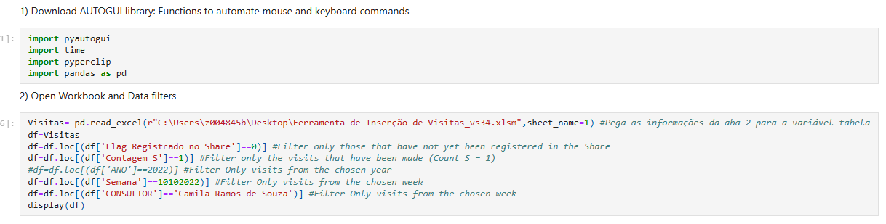
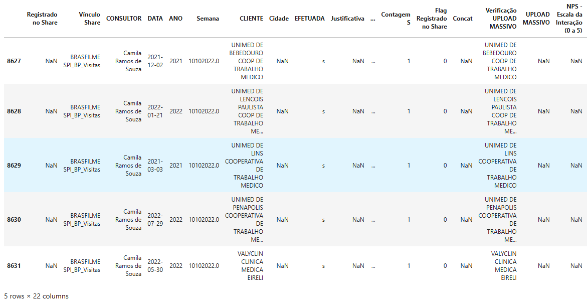

# 🖱️ Lançamentos de Visitas no Share (RPA)

Este projeto tem o objetivo de **automatizar a inserção de visitas em um sistema (SharePoint)**, preenchendo os campos necessários com os dados extraídos de um arquivo Excel.

**Metodologia:** Foram usados a IDE Jupyter e a linguagem Python.

## 🎯 Contexto e objetivo

O script carrega um arquivo Excel chamado `Ferramenta de Inserção de Visitas_vs34.xlsm` e filtra os dados de acordo com as condições abaixo:

- ➡️ Apenas visitas que ainda não foram registradas no "Share" (`Flag Registrado no Share = 0`)
- ➡️ Apenas visitas que foram efetivadas (`Contagem S = 1`)
- ➡️ Filtra por uma semana específica (`Semana = 10102022`)
- ➡️ Filtra por um consultor específico (`CONSULTOR = 'Camila Ramos de Souza'`)

Depois, o código executa um loop que percorre os dados filtrados e, para cada registro:

- ➡️ Cola o "Vínculo Share" no campo correspondente
- ➡️ Cola a "Data" no campo correspondente
- ➡️ Cola o nome do "Cliente" no campo correspondente
- ➡️ Define o status da visita como "Complete"
- ➡️ Clica em "Save and Continue"
- ➡️ Cola o nome do "Consultor" no campo correspondente
- ➡️ Clica em "Save and Close"
- ➡️ Abre uma nova visita
- ➡️ E repete com cada vendedor.

A automação usa a posição dos pixels da tela com a biblioteca **pyautogui**, que controla o mouse e o teclado.

## 💡 Insights e resultados

| Antes | Depois |
|---|---|
| ~**3 horas** para lançar as visitas semanais de todos os vendedores | ~**20 a 30 minutos** com o código rodando |

- 💡 **Antes:** um processo repetitivo e demorado, que levava cerca de 3 horas por semana.
- 💡 **Solução:** com o código rodando no computador, o lançamento passou a levar de 20 a 30 minutos.

## 🧰 Ferramentas

Python · Jupyter · pandas · pyautogui · pyperclip · Excel · SharePoint
